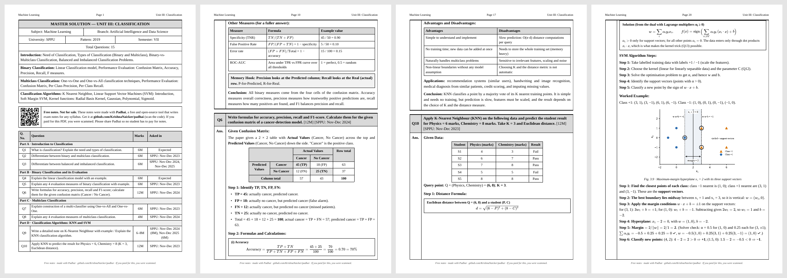

# Padhai (पढ़ाई)

**Give it your syllabus. Get back exam-ready notes.**

[](https://skills.sh/KrishnaNaicker/padhai)

*Padhai* means "studies", the word every Indian student hears every day. Padhai turns your syllabus into the notes you wish you had: complete, exam-ready, and free for every student.

Padhai is an open-source **Agent Skill**. You give an AI agent (Claude Code, Codex, Gemini CLI, Copilot, Cursor and others) your unit's syllabus, plus previous-year questions if you have them. It writes a **master-solution PDF**: every likely exam question with a full answer, written the way a topper writes it in the exam.



📄 **See a real output:** [`samples/ML_Unit3_Classification.pdf`](samples/ML_Unit3_Classification.pdf) (Machine Learning, Unit III, 30 pages)

---

## Start here: copy, paste, done

Open any AI agent that can run commands (Claude Code, Codex, Gemini CLI, OpenCode, Cursor, Copilot, or any other) and paste this prompt. It sets everything up, checks that it works, and then asks you for your syllabus.

```text
Set up Padhai (https://github.com/KrishnaNaicker/padhai), a free skill that makes exam notes, then use it to make my notes.

1. Install it as a skill: npx skills add KrishnaNaicker/padhai
   If that is not possible here, run: git clone https://github.com/KrishnaNaicker/padhai
   From now on, "the skill" means the skills/padhai folder, wherever it ended up.
2. Install the Python packages it needs: beautifulsoup4 matplotlib numpy pillow pypdf
   (use pip, a virtual environment, or whatever works on this system).
3. If Node.js is installed, run "npm install katex" inside the skill's scripts folder.
4. Check for Chrome, Edge, Chromium or Brave. If none is installed, tell me the notes will come as an HTML file I can print to PDF.
5. Test it: build the example in the skill's examples/ml-unit3-classification folder with scripts/build.py and confirm the notes file is created. Fix any setup problem you hit.
6. Read the skill's SKILL.md fully.
7. Tell me setup is done. Then ask me for the syllabus of the unit I want notes for, plus previous-year questions if I have them. Wait for my reply.
8. When I send them, follow SKILL.md exactly and give me the PDF.
```

That's it. Setup runs once. Next time, just type `/padhai` (or say *"make notes with padhai"*) and paste your syllabus.

## Is it safe?

Yes. Padhai is plain instructions plus a few small Python scripts that build your PDF. It doesn't need an account, doesn't collect your data, and doesn't send your notes anywhere. Everything is open here, so you can read every line.

If your installer shows a security warning: automated scanners are strict with skills that use web search or add a credit line to the output. Padhai does both (to check facts, and to add the free-notes footer). A fresh scan of the latest version has been requested.

## What you get

- **Every syllabus topic covered.** Previous-year questions (PYQs) are answered first. Any topic no paper has asked yet gets an **Expected** question, phrased the way your examiners phrase them.
- **No duplicate PYQs.** A question asked in three papers appears once, tagged with all three dates, so you know it's important.
- **Answer length follows marks.** A 2-mark answer is a few lines; an 8-mark answer is about 2 pages. Definitions, step-by-step points, diagrams, examples, comparison tables, advantages and limitations, and a conclusion.
- **Numericals worked step by step**: given → formula → substitution → result table → interpretation. Every number is computed in code, not guessed.
- **Clean diagrams** for processes, architectures, graphs and curves.
- **Rapid Revision Sheet** at the end: every formula, key one-liners, "if they ask X, write Y", and every numerical answer.
- **Marked as free, on every page.** Each PDF has a small footer on every page and a first-page notice with a QR code saying the notes are free and where to get Padhai, so nobody can quietly sell them to students who don't know.
- **A plain exam format**: black, grey and white with a serif font, bordered question/answer boxes and tables with Sr. No. columns. It looks like a topper's notebook, not a webpage.

Works for **any university, board or autonomous college**: SPPU, Mumbai University, VTU, AKTU, Anna University, GTU, RGPV, JNTU, and the rest.

## What to give

| | |
|---|---|
| **Required** | Subject, unit name, and the **syllabus** of the unit: typed, or a screenshot or photo of it |
| Optional | Previous-year questions: typed, screenshots, or full papers (say which question numbers belong to the unit) |
| Optional | University, course, semester, marks per question |

> A unit name on its own isn't enough. "Unit 3 Normalization" covers different topics at different universities, so Padhai asks for the syllabus first. If you don't have it, Padhai drafts a topic list and waits for you to confirm it.

**One unit per run, one PDF per unit.**

## How it works

1. **Collect** the syllabus and any PYQs, and ask once for anything missing.
2. **Plan**: list every syllabus topic, pull out the PYQs, merge duplicates, and add Expected questions for uncovered topics.
3. **Verify**: compute every number in code; look up facts that change over time.
4. **Draw** the figures, then check every one visually for overlapping labels.
5. **Write** each answer to fit its marks.
6. **Build** the PDF, then check every page visually and fix any problems.

The full method is in [`skills/padhai/SKILL.md`](skills/padhai/SKILL.md) and [`skills/padhai/references/`](skills/padhai/references/).

## Free, forever

Padhai is built so that no student has to pay for good notes. Every PDF it makes says so:

- a footer on every page: *Free notes · made with Padhai · github.com/KrishnaNaicker/padhai · If you paid for this, you were scammed.*
- a notice on the first page with a QR code to this repo;
- tags inside the PDF file.

The code is MIT licensed, so we can't legally stop anyone from selling copies. We're asking you not to. **If someone sold you notes made with Padhai, you can make your own for free right here.** Share the repo so more students know.

## Please read

- **Padhai is a study aid. Check it against your textbook and your teacher's notes.** AI can make mistakes. Padhai is built to reduce them (computed numericals, fact checks, visual checks), but it can't remove them completely.
- **Quality depends on the model.** A strong model with code execution gives notes like the sample. Smaller models give weaker notes.
- Subjects that need hand-drawn engineering drawings or detailed circuit schematics are only partly supported.
- Keep it free. If Padhai helped you, share it with someone who can't afford guidebooks.

## Other ways to install

**Any agent that supports skills** (Claude Code, Codex, Gemini CLI, GitHub Copilot, Cursor, and more):

```bash
npx skills add KrishnaNaicker/padhai
```

**Claude Code as a plugin:**

```
/plugin marketplace add KrishnaNaicker/padhai
/plugin install padhai@padhai
```

**Manual:** copy the `skills/padhai` folder into your agent's skills folder:

| Agent | Folder |
|---|---|
| Claude Code | `~/.claude/skills/` (all projects) or `.claude/skills/` (one project) |
| OpenAI Codex | `~/.codex/skills/` or `.agents/skills/` |
| Gemini CLI | `~/.gemini/skills/` or `.agents/skills/` |
| GitHub Copilot | `.github/skills/` |
| Cursor | `.cursor/skills/` |

**Chat apps that accept skill uploads** (e.g. Claude.ai): zip the `skills/padhai` folder and upload it as a skill.

**No skill support at all?** Paste the contents of `skills/padhai/SKILL.md` into the chat first, then give your syllabus. You'll get the same method, as Markdown notes.

### Requirements (for the PDF)

```bash
pip install beautifulsoup4 matplotlib numpy pillow
```
- Any **Chrome, Edge, Chromium or Brave** browser installed (used to print the PDF).
- Optional: Node.js and `npm install katex` inside `skills/padhai/scripts`, so maths renders offline. Without it, maths is rendered from a CDN, so you need internet when building.
- No browser? You still get an HTML file. Open it, press **Ctrl+P**, choose **Save as PDF**, and tick **Background graphics**.

The prompt in **Start here** does all of this for you.

## Contributing

Pull requests are welcome. The most useful contributions:

- **Sample units** for other universities and subjects, so the agent has more examples to learn from.
- Better figure helpers for specific subjects (circuits, ER diagrams, timing diagrams).
- Install notes for more agents.

Open an issue before large changes.

## Credits

Created by [Krishna Naicker](https://github.com/KrishnaNaicker), built with Claude. The format comes from real end-semester notes that friends compared side by side against paid guidebooks.

MIT licensed. Free for every student, forever.
